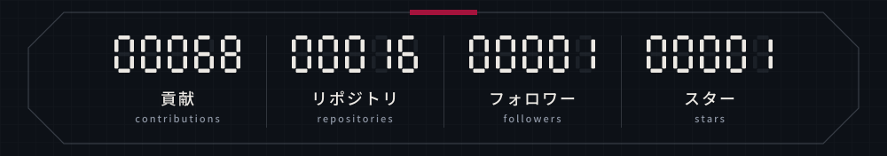

<div align="center">


✦ ━━━━━━ ◈ ━━━━━━ ✦

</div>

## ✦ about / 概要

```text
sky@arasaka  ✦  荒坂 蒼空
────────────────────────────
🏢 荒坂社 · arasaka corp
🌏 australia  [utc+10:30]
🛠️ homelab / ui tinkerer
🎨 retro-cyberpunk, 80s-90s meets modern
💫 the one thing you should never give up on,
   is the desire to become the person you want to be.
```

<div align="center">


✦ ━━━━━━ ◈ ━━━━━━ ✦

</div>

## ✦ projects / プロジェクト

| #  | project | description | status |
|:--:|:--------|:------------|:------:|
| 01 | **[arasaka-ui-terminal](https://github.com/itsbabp/arasaka-ui-terminal)** | Arasaka-themed Windows utility. `.bat` menu (Arasaka CLI) and a PowerShell GUI (Arasaka UI) | 🟢 active |
| 02 | **Arasaka Vencord theme** | Discord theme with the Arasaka look and Japanese labels after UI names | 🟢 active |
| 03 | **[website](https://github.com/itsbabp/website)** | Arasaka retro-cyberpunk homelab home page / photography site | 🛠️ in dev |

<div align="center">

✦ ━━━━━━ ◈ ━━━━━━ ✦

</div>

## ✦ stack / 技術

`batch` · `powershell` · `css` · `html`

<div align="center">

✦ ━━━━━━ ◈ ━━━━━━ ✦

</div>

## ✦ stats / 統計



<div align="center">

✦ ━━━━━━ ◈ ━━━━━━ ✦

</div>

## ✦ contact / 連絡

▌ [bit.ly/pixiebabp](https://bit.ly/pixiebabp)  ·  say hi anytime (੭˃ᴗ˂)੭

<div align="center">

<sub>荒坂 // end of file</sub>

</div>
