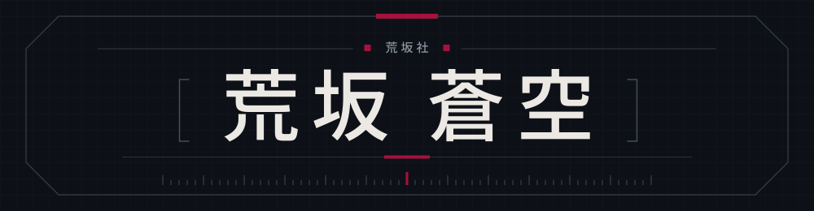

<div align="center">




</div>

## about / 概要

```text
▌ name       : 荒坂 蒼空 
▌ handle     : sky  (itsbabp)
▌ base       : australia  [utc+10:30]
▌ class      : homelab / ui tinkerer
▌ aesthetic  : retro-cyberpunk, 80s-90s meets modern
▌ quote      : the one thing you should never give up on,
               is the desire to become the person you want to be.
```


## projects / プロジェクト

| #  | project | description | status |
|:--:|:--------|:------------|:------:|
| 01 | **[arasaka-ui-terminal](https://github.com/itsbabp/arasaka-ui-terminal)** | Arasaka-themed Windows utility. `.bat` menu (Arasaka CLI) and a PowerShell GUI (Arasaka UI) | active |
| 02 | **Arasaka Vencord theme** | Discord theme with the Arasaka look and Japanese labels after UI names | active |
| 03 | **[website](https://github.com/itsbabp/website)** | Arasaka retro-cyberpunk homelab home page / photography site | in dev |


## stack / 技術

`batch` · `powershell` · `css` · `html`


## stats / 統計


## contact / 連絡

▌ [bit.ly/pixiebabp](https://bit.ly/pixiebabp)

<div align="center">

(Last name is a joke)

<sub>荒坂 // end of file</sub>

</div>
