<div align="center">




</div>


## ABOUT / 概要

<table>
<tr>
<td width="150" align="center">

</td>
<td>

```text
▌ HANDLE     : SKY  (itsbabp)
▌ BASE       : AUSTRALIA  [UTC+10:30]
▌ CLASS      : HOMELAB / UI TINKERER
▌ AESTHETIC  : RETRO-CYBERPUNK, 80s-90s MEETS MODERN
▌ DIRECTIVE  : DON'T GO GENTLE INTO THAT GOOD NIGHT
```

</td>
</tr>
</table>

I build themes, tools and interfaces with an old-future look: crimson, shadow black, pixel type and a lot of Japanese labels.
Most of my work is private for now, so the file below lists what exists and what is still classified.


## PROJECTS / プロジェクト

| #  | PROJECT | DESCRIPTION | STATUS |
|:--:|:--------|:------------|:------:|
| 01 | **[arasaka-ui-terminal](https://github.com/itsbabp/arasaka-ui-terminal)** | Arasaka-themed Windows utility. `.bat` menu (Arasaka CLI) and a PowerShell GUI (Arasaka UI) |  |
| 02 | **Arasaka Vencord theme** | Discord theme with the Arasaka look and Japanese labels after UI names |  |
| 03 | **Arasaka phone theme** | Android (One UI) theme, follow-up to the Discord theme |  |
| 04 | **[website](https://github.com/itsbabp/website)** | Arasaka retro-cyberpunk homelab home page / photography site |  |
| 05 | **Empire-of-Vaults** | `[REDACTED]` (write your own one-liner here) |  |
| 06 | **[glados-tts-voice-wizard](https://github.com/itsbabp/glados-tts-voice-wizard)** | Fork of a GLaDOS text-to-speech tool (Python) |  |

> Private repos can't be opened by visitors, so only link the ones that are public. Unlinked rows are fine, it adds to the "classified" feel.


## STACK / 技術


## CONTACT / 連絡

▌ [bit.ly/pixiebabp](https://bit.ly/pixiebabp)

<!--
Optional: re-enable your lowlighter/metrics output here once the workflow is generating it.


## TELEMETRY / 統計


-->

<div align="center">

<sub>荒坂 // END OF FILE</sub>

</div>
